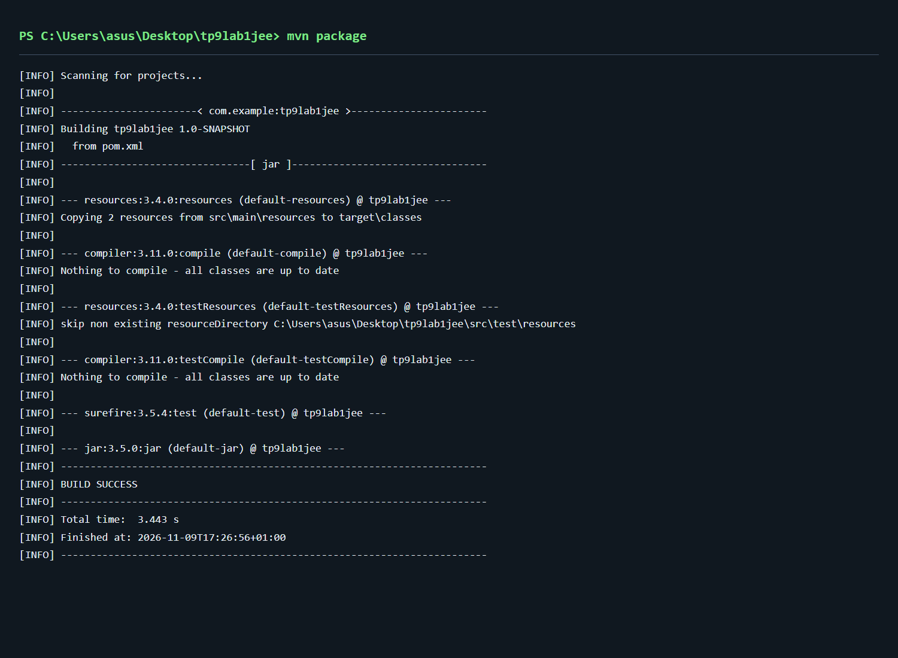
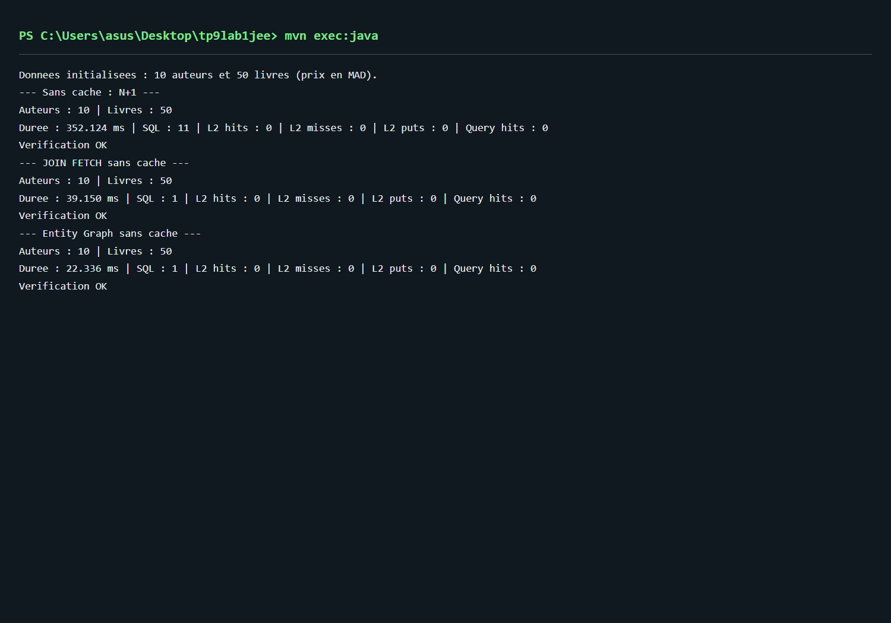
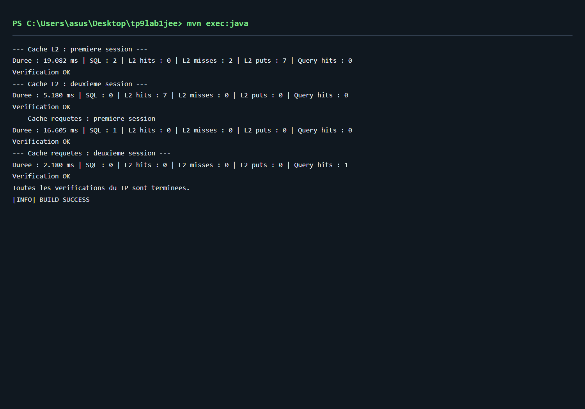

# TP 9 — Optimisation JPA et cache Hibernate

Application Java SE de gestion d'une bibliothèque, avec JPA 2.2, Hibernate 5.4, Ehcache et H2 en mémoire. Elle compare le chargement LAZY, JOIN FETCH, Entity Graph et les caches Hibernate.

## Personnalisation

| Entité | Champs ajoutés |
| --- | --- |
| Auteur | nationalité, date de naissance, email unique |
| Livre | ISBN-13 unique, genre, année de publication, prix en MAD, disponibilité |

Les données fictives contiennent 10 auteurs de plusieurs nationalités et 50 livres répartis dans cinq genres. Les ISBN incluent une clé de contrôle. Les relations sont bidirectionnelles ; l'ajout et le retrait passent par les méthodes de l'auteur. `cascade = ALL` propage les opérations aux livres et `orphanRemoval = true` supprime un livre retiré de la collection lors de la synchronisation.

## Configuration retenue

L'énoncé mélange `hibernate-ehcache` (Ehcache 2) avec un fournisseur JCache et un XML Ehcache 3. Ce projet utilise une seule intégration cohérente : `hibernate-ehcache:5.4.32.Final`, `net.sf.ehcache:ehcache:2.10.6` et `EhCacheRegionFactory`. Le fichier `ehcache.xml` emploie donc le format Ehcache 2.

Le cache READ_WRITE est activé sur les deux entités et sur la collection `Auteur.livres`. Les régions de données expirent après une heure ; la région des horodatages n'expire pas. Le cache de requêtes est activé explicitement sur la requête qui le démontre.

L'application utilise des transactions RESOURCE_LOCAL gérées manuellement et des services construits avec l'EntityManagerFactory. Aucune injection de conteneur JEE n'est nécessaire. La base H2 est recréée à chaque lancement puis supprimée à la fermeture.

## Organisation

```text
src/main/java/com/example/
  App.java
  model/Auteur.java
  model/Livre.java
  service/DataInitService.java
  service/PerformanceTestService.java
src/main/resources/
  META-INF/persistence.xml
  ehcache.xml
docs/screenshots/
```

## Comment tester avant le dépôt GitHub

Ces commandes permettent de reproduire les vérifications depuis le dossier contenant `pom.xml`. La compilation et les sept contrôles intégrés ont été exécutés avec succès avec OpenJDK 11.0.31 et Maven 3.9.13. Les captures en fin de document affichent les extraits des logs réels dans une vue de lecture.

1. Utiliser de préférence un JDK 11 et Maven 3.8 ou supérieur. Vérifier que Maven utilise le bon JDK :

   ```powershell
   java -version
   mvn -version
   ```

2. Compiler et créer le JAR :

   ```powershell
   mvn clean package
   ```

   Attendre `BUILD SUCCESS`. Cette étape compile le projet ; elle ne lance pas les vérifications fonctionnelles de `App` et le projet ne contient pas de tests JUnit.

3. Lancer les scénarios et leurs contrôles intégrés :

   ```powershell
   mvn exec:java
   ```

   Vérifier les compteurs suivants dans les lignes récapitulatives. Les instructions de création, d'insertion et de suppression du schéma ne font pas partie de ces mesures.

   | Scénario | Requêtes SQL attendues |
   | --- | ---: |
   | LAZY avec cache ignoré | 11 : 1 pour les auteurs et 10 pour leurs collections |
   | LEFT JOIN FETCH DISTINCT avec cache ignoré | 1 |
   | Entity Graph avec cache ignoré | 1 avec cette configuration Hibernate |
   | Cache L2, première session : un auteur et ses cinq livres | 2 |
   | Cache L2, deuxième session | 0, avec des hits L2 |
   | Cache de requêtes, première session : identifiants des auteurs | 1 |
   | Cache de requêtes, deuxième session | 0, avec un hit de requête |

   Les trois premiers scénarios vérifient aussi la présence de 10 auteurs et 50 livres. Chaque mesure crée puis ferme son propre EntityManager. Les régions sont vidées avant chaque paire de lectures avec cache. Une différence de compteur provoque une exception : ne pas déposer le projet comme validé avant d'avoir compris l'écart. Le message final attendu est `Toutes les verifications du TP sont terminees.`, suivi de `BUILD SUCCESS`.

4. Relancer `mvn exec:java` pour vérifier que le résultat est reproductible. Les durées varient avec la JVM, l'échauffement et la machine ; une baisse du temps n'est pas garantie sur seulement 50 livres. Le nombre de requêtes et les hits constituent les critères principaux.

5. Les captures sont enregistrées dans `docs/screenshots/` et intégrées ci-dessous. Elles peuvent être remplacées après une nouvelle exécution.

6. Avant publication, contrôler les fichiers à envoyer :

   ```powershell
   git status
   git diff
   ```

   Si le dossier n'est pas encore un dépôt Git, lancer d'abord `git init`. Vérifier que `target/`, `.idea/` et les fichiers locaux ne sont pas inclus. Ajouter les fichiers du projet et les captures, puis créer le commit :

   ```powershell
   git add pom.xml src README.md .gitignore docs
   git diff --cached
   git commit -m "Ajout du TP JPA Hibernate et cache de second niveau"
   ```

   Créer ensuite un dépôt vide sur GitHub, puis remplacer l'URL ci-dessous par celle de ton dépôt :

   ```powershell
   git branch -M main
   git remote add origin https://github.com/TON_COMPTE/TON_DEPOT.git
   git push -u origin main
   ```

   Si `origin` existe déjà, vérifier son adresse avec `git remote -v` avant de publier.

## Concepts clés

Le cache de premier niveau appartient à un EntityManager. Le cache de second niveau est partagé entre les EntityManagers de la même fabrique et conserve les entités par identifiant. Le cache de collection conserve les identifiants des éléments associés ; les entités Livre sont elles aussi mises en cache.

Une requête JPQL ordinaire peut toujours exécuter du SQL même si les entités sont dans le cache L2. C'est pourquoi le scénario L2 utilise `find` dans deux sessions distinctes. Le scénario de cache de requêtes utilise séparément une projection d'identifiants avec le hint `org.hibernate.cacheable`.

Le problème N+1 apparaît lors du parcours des dix collections LAZY après la requête des auteurs. `LEFT JOIN FETCH` charge les associations en une requête et conserve aussi les auteurs sans livre. `DISTINCT` élimine les doublons d'auteurs. L'Entity Graph exprime le même besoin de chargement sans ajouter de jointure au texte JPQL ; le SQL dépend du fournisseur JPA.

## Captures d'écran






